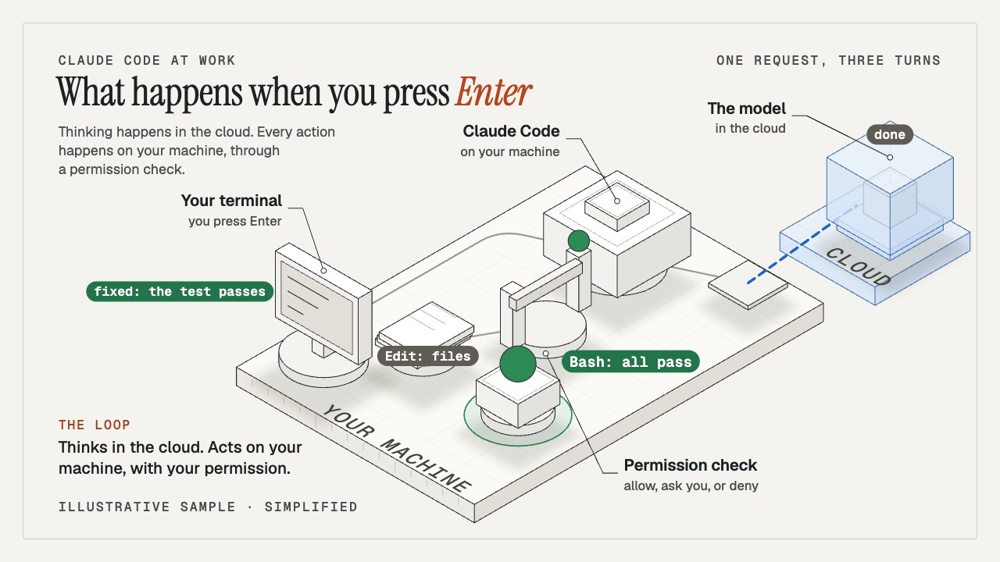

# Living diagrams: what happens when you press Enter, and two live figures

A 27-second living diagram of a coding agent's loop, and two live figures made from diagram scenes. The film is
`showtime new diagram --example enter` rendered as it comes: your terminal, Claude Code and its tools on a plate
labelled "your machine", the model in a glass cube labelled "cloud". The request is typed, the camera pulls back
as the system builds, and three turns run through it: the request goes up, a tool call comes down, passes the
permission check (allowed, then "asks you"), and the tests go from 1 failing to all passing. Nothing on screen is
drawn by hand: parts, pipes, packets, labels and the camera all come from one `scene.js`.

The live figures are the same kind of scene exported with `showtime export html <project> --interactive`: one
offline file each, no player, a board people hover, step through and tune. `econ-lab-figure.html` is the economics
lab (households, firms and a central bank in a loop; turn the rule's strength and the inflation, output gap and
policy rate readouts answer); `enter-figure.html` is the Enter loop above, where the permission check is the knob.



| File | What it is |
|---|---|
| `enter-720p.mp4` | the film, 1280x720, 30 fps, 27.0 s, a composed bed at -14 LUFS, 8.6 MB |
| `poster.jpg` | the film's poster, a still near the end (the scene sets `"poster": 26.2`) |
| `econ-lab-figure.html` | the live figure of `--example econ-lab`, 394 KB, one file, no network requests |
| `enter-figure.html` | the live figure of `--example enter`, 399 KB, one file, no network requests |
| [`project/`](project/) | the film's project: `index.html` (the film), `figure.html` (the live page), `scene.js`, `showtime.json`, `audio/mix.json` |

Make them again from the repository root:

```
ST=skills/showtime/bin/showtime
$ST new diagram enter --example enter
$ST check enter
$ST render enter --scale 0.6667 --crf 22 -o enter-720p.mp4
$ST export html enter --interactive -o enter-figure.html

$ST new diagram lab --example econ-lab
$ST export html lab --interactive -o econ-lab-figure.html
```

(`showtime render` never overwrites: delete the old file first, or it writes `enter-720p-2.mp4`.) The film
rendered in 47 s of capture with 3 workers on a 6-core Intel Mac.

## The live figure

Open `econ-lab-figure.html` in a browser, offline. The board is built and moving from the first frame:

- **Hover or tab to a part** and the focus veil lights it and its own pipes; a card says what it is.
- **Pick a step**: each one is an experiment that runs on the board (a spending burst, a cost shock, a promise
  to hold the rate). Arrow keys and 1-9 move between steps, R runs one again.
- **Turn a knob**: on the cost shock, the rule's strength (0.8, 1.5, 3) runs the step again, and the readouts
  under the figure answer at once (with the rule at 3: inflation +0.84 instead of +1.28, the rate +2.10).
- **Link to what you see**: L copies a link such as `#step=cost&rule=3`, which opens that state.
- Untouched, a short tour plays and stops at any touch. Reduced motion shows it still (input works); on a phone the
  words leave the drawing for the panel.

The file embeds the runtime, the scene, its fonts and their licences, and blocks every network request with a
Content-Security-Policy. It carries every word and number in the scene, so sharing it shares all of that.

## Checks

- `showtime check` passed with 0 errors on both projects. For the live figure it walks `figure.html` at rest:
  every step, each knob value and each hovered part, looking for cut or overlapping text and broken readouts.
- One warning on the Enter project: on a phone, one tag of the live figure ("message, chat so far, CLAUDE.md")
  is drawn at 11.5 px, under 12 px. The econ-lab figure has no such warning.
- The film's labels come from a layout pass that scores candidate places at every camera pose; `showtime check`
  reports a label that collides or never shows whole as a `diagram:` warning (none here).

Guide: [`references/workflows/diagram.md`](https://github.com/FavioVazquez/showtime/blob/main/skills/showtime/references/workflows/diagram.md) (§ Interactive
for the live figure) and [`references/html-export.md` § Live figure](https://github.com/FavioVazquez/showtime/blob/main/skills/showtime/references/html-export.md#live-figure).

## Credits

- Music: a bed composed by showtime on this machine (`underscore`), no licence needed.
- Fonts packed into the live figures: Inter and JetBrains Mono (SIL Open Font License); the licences are inside
  each file.
- The economics lab's numbers come from the set-the-rate toy's results that ship with the template: a textbook
  model with an illustrative calibration, as the line under the figure says. An educational demo, not research.
