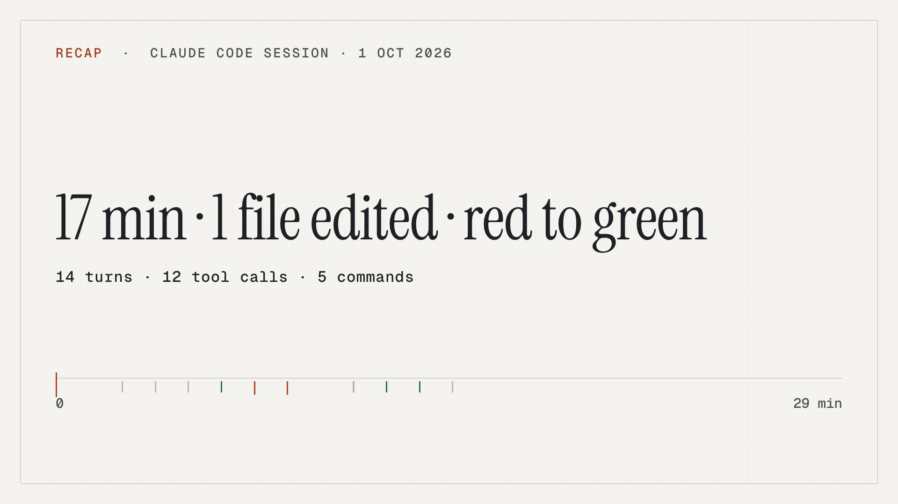

# Recap: a Claude Code session as a 37-second film

`showtime recap` on the test session that ships with showtime: an agent asked to fix a flaky parser test in a
small repository, 17 minutes of work. The film says what happened in numbers and nothing else: the title from the
facts ("17 min · 1 file edited · red to green"), 14 turns and 12 tool calls, a minute-by-minute timeline of the
files read and edited and the commands and tests run, where the edit landed (`src/parser.py`, +4 -1), the tests
red once and then green, the commit from git, and an end card. Narrated with a local voice, captioned, in the
light paper look.

The session is not a real one: it is `skills/showtime/tests/fixtures/recap/session.jsonl`, pointed at a fresh
two-commit git repository the way `test_recap.py` does it. It holds the traps a real transcript holds (paths
outside the repository, a fake GitHub token, a free-text request, commands that are not on the list), so this
film also shows what recap leaves out.



| File | What it is |
|---|---|
| `recap.mp4` | the film, 1920x1080, 30 fps, 37.0 s, H.264 + AAC, -14.0 LUFS, -1.3 dBTP, 5.6 MB |
| `poster.jpg` | the film's poster, its title card |
| `script.md` | every line the film shows (`show`) or speaks (`say`), as recap wrote it; the film is made from this file only |
| `facts.json` | the allow-listed facts recap read from the session: counts, repository-relative paths, program names, test counts, git stats |
| `credits.txt` | the music credit |

## How it was made

```
# writes script.md and facts.json, then stops
showtime recap session.jsonl --repo acme --out recap-out
# after reading script.md: narrate, check, render, qa
showtime recap session.jsonl --repo acme --out recap-out --yes
```

The first call printed `17 min, 14 turns, 12 tool calls, 1 repo file, 1 edited, 3 test runs (red to green), +4 -1
in 1 file, 2 paths outside the repo left out` and stopped: a call that writes `script.md` never renders, `--yes` or
not. In your own repository, `showtime recap --latest` picks this folder's newest session. The second call took
1 min 36 s on a 6-core Intel Mac (1 min 06 s of it the render).

## What reached the film, and what did not

- **In:** the session's times, turn and tool counts, `src/parser.py` (a file inside the repository), program
  names from a fixed list (`python -m pytest`, `tail`, `curl`, `jq`), the three test runs' counts read from their
  output, and the commit, whose hash `git commit` printed and git knows, with its diff stats.
- **Out:** the two paths outside the repository, the fake token, the assistant's text, tool output (read only to
  count tests and commits) and the request. The request ("Fix the flaky parser test in acme. Keep the change
  small.") is only offered in `script.md` as a commented `# show` line; it reaches the film only if you uncomment it.
- A hard filter then drops any line that still looks like a key, a path, a URL, a host or an e-mail address, also
  in lines you write. It is there to keep private text that slips in by accident out of the film; it does not stop
  you from disguising your own text on purpose, which is why nothing renders until you have read `script.md`.

## Checks

- `showtime qa` on the film: WARN with one finding, a level jump in the bed at the cut at 19.8 s (-16.4 to -24.8
  LUFS). Loudness, true peak and the read-back (7 lines heard back, 14 names and
  numbers as written) pass.

Guide: [`references/workflows/recap.md`](https://github.com/FavioVazquez/showtime/blob/main/skills/showtime/references/workflows/recap.md).

## Credits

- Music: 'With These Hands' by Scott Buckley – released under CC-BY 4.0. www.scottbuckley.com.au
  ([CC BY 4.0](https://creativecommons.org/licenses/by/4.0/)), picked from showtime's music catalog for this
  session and downloaded once from the creator's site. The music ships only inside the film. It is protected by
  Smart Content ID: keep the credit in the video's description, or YouTube will claim the video.
- Voice: `af_heart`, a local Kokoro voice.

Full credits: [`credits.txt`](credits.txt).
