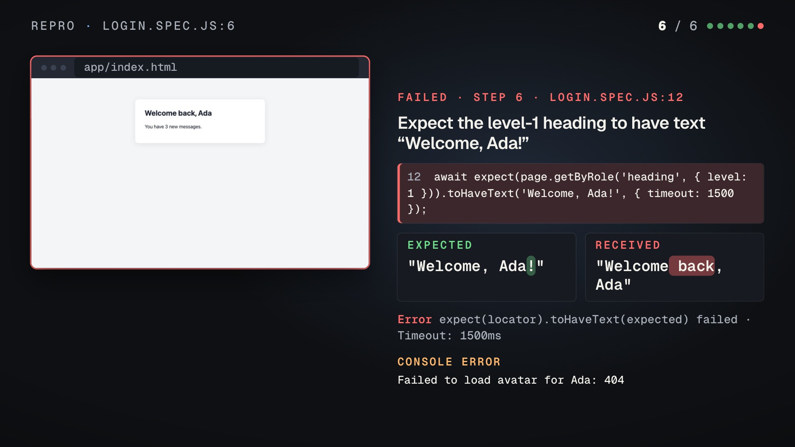

# Repro: a failing Playwright test as a 34-second bug-report video

`showtime repro` on the trace of a test that fails on purpose: "signs in and greets the user" types an e-mail
address, a password and an API token into a sign-in page, clicks Sign in, and expects the heading to say
"Welcome, Ada!". The page says "Welcome back, Ada". The film shows the title card (the test, `login.spec.js:6`,
FAILED), each step on the trace's own screenshots with a cursor and the target boxed, then the failing step slowed
down: the source line, expected against received with the difference marked, the error, and the page's console
error. Narrated with a local voice and captioned. `repro.md` is the summary to paste into the issue.

The test, its page and its trace are the fixtures in `skills/showtime/tests/fixtures/repro/` (`login.spec.js`,
`app/index.html`, `trace.zip`); every value typed into them is a made-up test value.



| File | What it is |
|---|---|
| `repro.mp4` | the film, 1920x1080, 30 fps, 33.6 s, H.264 + AAC, -14.0 LUFS, -1.6 dBTP, 8.3 MB |
| `poster.jpg` | the film's poster, the failing step |
| `repro.md` | the Markdown for the issue: the steps, the failure, the console errors and the re-run commands |
| `repro.srt` | the captions |
| `script.md` | every line the film shows or speaks, as repro wrote it before the render |
| `credits.txt` | the music credit |

## How it was made

```
# writes script.md, then stops
showtime repro trace.zip --out repro-out
# after reading script.md: narrate, check, render, qa
showtime repro --yes repro-out
```

From a test command instead of a trace: `showtime repro -- npx playwright test login.spec.js` runs the test with
`--trace retain-on-failure` added and films the failing trace. The `--yes` call took 2 min 30 s on a 6-core Intel Mac.

## What the film does not show

- **Typed values.** The three fields a value was typed into are covered on every screenshot, and the captions say
  how many characters went in ("Type 16 characters into the 'Email' field"), never what they were.
- **Paths, query strings and secrets.** The test opens the page with a session id in its query string; the film
  and `repro.md` show `app/index.html` only. Paths on the machine are shortened to the file name; auth headers,
  `NAME=value` secrets and e-mail addresses are masked in every line, and `--redact <regex>` masks more.
- Screenshots are otherwise shown as they were captured: use a test account, and watch the film before you post it.

## Checks

- `showtime qa` on the film: WARN with one finding: the read-back heard the name "Ada" as "eta" at 27.3 s (the
  captions say "Ada"). Loudness and true peak pass.

Guide: [`references/workflows/repro.md`](https://github.com/FavioVazquez/showtime/blob/main/skills/showtime/references/workflows/repro.md).

## Credits

- Music: "The space is big" by Komiku (CC0), from the album "Little Cat In The Big Wide Space", picked from
  showtime's music catalog for this test. A courtesy credit; CC0 needs none.
- Voice: `af_heart`, a local Kokoro voice.

Full credits: [`credits.txt`](credits.txt).
